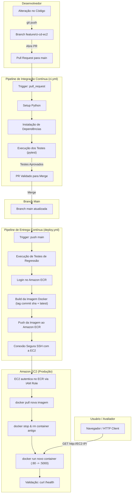

# DevOps Python API — CI/CD Pipeline

> **Trabalho Prático da Disciplina:** Integração DevOps  
> **Repositório:** `devops-python-api`  
> **Modalidade:** Atividade prática de esteira completa de CI/CD

---

## 1. Descrição da Aplicação e seu Objetivo

A **devops-python-api** é uma API REST desenvolvida em Python (Flask) projetada para demonstrar uma esteira completa e automatizada de **Integração Contínua (CI)** e **Entrega Contínua (CD)**.

O objetivo do projeto é eliminar processos manuais de publicação (atualização de código no servidor via SSH, compilação de imagens manuais e reinicialização de containers), substituindo-os por uma solução DevOps profissional, reprodutível, rastreável e segura, com validação de testes automatizados e deploy automático na nuvem da AWS.

---

## 2. Tecnologias Utilizadas

- **Linguagem & Framework:** Python 3.12, Flask, Gunicorn (servidor WSGI de produção).
- **Testes Automatizados:** Pytest, Pytest-cov.
- **Containerização:** Docker (imagem multi-camada otimizada com usuário não-root).
- **Integração Contínua (CI):** GitHub Actions (`ci.yml`).
- **Entrega Contínua (CD):** GitHub Actions (`deploy.yml`).
- **Registro de Imagens:** Amazon Elastic Container Registry (ECR).
- **Hospedagem & Computação:** Amazon Elastic Compute Cloud (EC2) rodando Ubuntu Linux.
- **Segurança & Governança:** AWS IAM Roles (leitura no ECR para EC2 sem credenciais estáticas), GitHub Actions Secrets, Security Groups.

---

## 3. Arquitetura da Solução



---

## 4. Instruções para Execução Local

### Pré-requisitos
- Python 3.10+ instalado.
- Gerenciador de pacotes `pip`.

### Passo a passo

1. **Clonar o repositório:**
   ```bash
   git clone https://github.com/<seu-usuario>/devops-python-api.git
   cd devops-python-api
   ```

2. **Criar e ativar o ambiente virtual:**
   - No Linux/macOS:
     ```bash
     python3 -m venv venv
     source venv/bin/activate
     ```
   - No Windows (PowerShell):
     ```powershell
     python -m venv venv
     .\venv\Scripts\Activate.ps1
     ```

3. **Instalar as dependências:**
   ```bash
   pip install -r requirements.txt
   ```

4. **Executar a suíte de testes automatizados:**
   ```bash
   pytest -v
   ```

5. **Iniciar a aplicação localmente:**
   ```bash
   python app.py
   ```
   A aplicação estará disponível em `http://localhost:5000`.

---

## 5. Procedimento de Construção e Execução com Docker

### 1. Construir a imagem Docker localmente:
```bash
docker build -t devops-python-api:local .
```

### 2. Executar o contêiner:
```bash
docker run -d --name devops-python-api -p 5000:5000 devops-python-api:local
```

### 3. Verificar o funcionamento:
```bash
# Consultar status do contêiner
docker ps

# Testar endpoint via curl
curl http://localhost:5000/
curl http://localhost:5000/health
```

### 4. Parar e remover o contêiner:
```bash
docker stop devops-python-api
docker rm devops-python-api
```

---

## 6. Descrição da Pipeline de Integração Contínua (CI)

- **Arquivo:** `.github/workflows/ci.yml`
- **Gatilho (Triggers):** Disparado automaticamente na abertura ou atualização de qualquer **Pull Request com destino à branch `main`**.
- **Etapas executadas:**
  1. *Checkout* do repositório no runner `ubuntu-latest`.
  2. Configuração do ambiente Python 3.12 com cache de dependências.
  3. Atualização do `pip` e instalação dos pacotes especificados em `requirements.txt`.
  4. Execução dos testes automatizados utilizando `pytest -v`.
  5. Notificação de sucesso ou falha da validação.
- **Garantia de Qualidade:** O merge para a branch `main` é condicionado ao sucesso incondicional desta pipeline. Se qualquer teste falhar, o PR não poderá ser mesclado.

---

## 7. Descrição da Pipeline de Entrega Contínua (CD)

- **Arquivo:** `.github/workflows/deploy.yml`
- **Gatilho (Triggers):** Disparado automaticamente após qualquer atualização aprovada e incorporada à branch `main` (`push` direto ou via merge de PR).
- **Etapas executadas:**
  1. **Job `test`:** Revalidação de testes automatizados para evitar regressões.
  2. **Job `build-and-deploy` (dependente do teste):**
     - Autenticação segura na AWS via `aws-actions/configure-aws-credentials` utilizando GitHub Secrets.
     - Login no Amazon ECR via `aws-actions/amazon-ecr-login`.
     - *Build* da imagem Docker com dupla identificação: tag única associada ao commit (`${{ github.sha }}`) e tag `latest`.
     - *Push* automático das imagens para o repositório privado no Amazon ECR.
     - Conexão segura via SSH com a instância Amazon EC2 (`appleboy/ssh-action`).
     - Execução do deploy remoto autônomo na instância:
       - Autenticação do Docker no ECR utilizando a **IAM Role** anexada à instância EC2.
       - Download (*pull*) da imagem referente ao commit SHA.
       - Parada e remoção do contêiner anterior em execução.
       - Inicialização do novo contêiner mapeado na porta pública 80 (`-p 80:5000`).
       - Verificação de saúde em tempo real (`curl http://localhost:80/health`).
       - Limpeza de imagens Docker órfãs (`docker image prune`).

> **Importante:** O processo de implantação é 100% automatizado, atendendo à exigência de não requerer intervenção manual no servidor.

---

## 8. Endereço de Acesso e Endpoints da API

- **URL Base:** `http://<IP_PUBLICO_EC2>` (ou DNS público)
- **Porta:** 80 (HTTP)

### Endpoints Disponíveis

| Método | Endpoint | Descrição | Exemplo de Resposta |
| :--- | :--- | :--- | :--- |
| `GET` | `/` | Informações gerais da API e status | `{"service": "devops-python-api", "status": "online", "version": "1.0.0"}` |
| `GET` | `/health` | Health check da aplicação | `{"status": "healthy", "version": "1.0.0", "environment": "production"}` |
| `GET` | `/api/v1/info` | Metadados do projeto e disciplina | `{"name": "devops-python-api", "discipline": "Integração DevOps", ...}` |
| `GET` | `/api/v1/version` | Versão ativa da API | `{"application": "devops-python-api", "version": "1.0.0"}` |
| `GET` | `/api/v1/tools` | Ferramentas DevOps utilizadas | `{"tools": [{"name": "Docker", ...}, ...]}` |

---

## 9. Instruções para Verificar a Versão Implantada

Para validar a versão em execução diretamente no ambiente implantado:

1. **Via Navegador:**  
   Acesse a URL `http://<IP_PUBLICO_EC2>/api/v1/version`
2. **Via Linha de Comando (curl):**  
   ```bash
   curl http://<IP_PUBLICO_EC2>/api/v1/version
   ```
3. **No Terminal da Instância EC2:**  
   ```bash
   docker ps --filter "name=devops-python-api"
   ```

---

## 10. Evidências de Execução das Pipelines

*(Insira abaixo os prints exigidos para entrega no Moodle, conforme diretrizes da disciplina)*

### A. Integração Contínua (GitHub Actions)
> *Print demonstrando a execução bem-sucedida do workflow `ci.yml` na abertura do Pull Request:*  
> `[Espaço reservado para Screenshot 01: Actions CI - Testes Aprovados]`

### B. Publicação da Imagem no Amazon ECR
> *Print do console do Amazon ECR exibindo a imagem publicada com a tag do commit e a tag latest:*  
> `[Espaço reservado para Screenshot 02: Console AWS ECR com as tags publicadas]`

### C. Deploy Automatizado na Instância Amazon EC2
> *Print da execução com sucesso do workflow `deploy.yml`:*  
> `[Espaço reservado para Screenshot 03: Actions CD - Deploy com sucesso]`

> *Print do terminal da instância EC2 exibindo o contêiner rodando (`docker ps`):*  
> `[Espaço reservado para Screenshot 04: Terminal EC2 - docker ps]`

> *Print da aplicação acessada pelo navegador no IP público da EC2:*  
> `[Espaço reservado para Screenshot 05: Navegador acessando http://<IP-EC2>/]`

### D. Demonstração de Atualização Automática (Etapa 7)
> *Comparativo comprovando a atualização de versão da v1.0.0 para v1.1.0 sem intervenção manual na EC2:*  
> `[Espaço reservado para Screenshot 06: Resposta do endpoint antes e depois do merge]`

---

## 11. Boas Práticas de Segurança

- Nenhuma credencial estática, senha, token ou chave privada foi incluída no código ou neste repositório.
- A instância EC2 utiliza uma **IAM Role** com política restrita de leitura (`AmazonEC2ContainerRegistryReadOnly`) para baixar imagens do ECR.
- As credenciais temporárias de CI/CD para publicação no ECR e acesso à EC2 são injetadas estritamente por meio de **GitHub Secrets**.
- A imagem Docker é executada sob um usuário não-root (`appuser`), mitigando riscos de escalonamento de privilégios.
