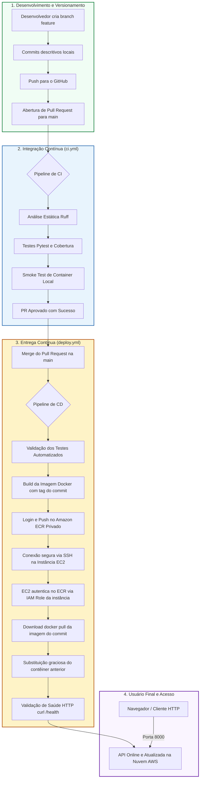

# DevOps Python API - Esteira Completa de CI/CD (GitHub Actions, Docker, Amazon ECR e EC2)


Repositório prático da disciplina **Integração DevOps**, com a implementação de um fluxo automatizado de integração contínua (CI) e entrega contínua (CD) na nuvem Amazon Web Services (AWS), utilizando boas práticas de segurança, testes e infraestrutura como código/conteinerizada.

---

## 1. Descrição da Aplicação e seu Objetivo

A aplicação é uma **API RESTful de gerenciamento de tarefas (Tasks)** desenvolvida com o framework **FastAPI** em **Python**. 

### Objetivo
Demonstrar na prática uma esteira moderna de entrega de software (CI/CD):
- Eliminar processos manuais e falhos de implantação (como transferir código via FTP ou rodar comandos manualmente no servidor).
- Garantir que toda alteração passe por baterias automáticas de qualidade de código (linter e formatação) e testes unitários.
- Empacotar a aplicação de forma imutável e isolada em imagem **Docker**.
- Armazenar versões versionadas no registro privado **Amazon ECR**.
- Realizar a implantação contínua e sem intervenção manual em uma instância **Amazon EC2**, utilizando autenticação segura baseada em **IAM Role**.

### Principais Endpoints

| Método | Endpoint | Descrição | Resposta de Sucesso |
| :--- | :--- | :--- | :--- |
| `GET` | `/` | Boas-vindas e status da API | `200 OK` |
| `GET` | `/health` | Healthcheck (status da aplicação e versão ativa) | `200 OK` |
| `GET` | `/tasks` | Lista todas as tarefas cadastradas | `200 OK` |
| `POST` | `/tasks` | Cria uma nova tarefa (`title` entre 3 e 80 caracteres) | `201 Created` |
| `PATCH` | `/tasks/{id}/done` | Marca uma tarefa como concluída | `200 OK` ou `404 Not Found` |
| `GET` | `/docs` | Documentação interativa Swagger UI | `200 OK` |

---

## 2. Tecnologias Utilizadas

| Tecnologia | Finalidade no Projeto |
| :--- | :--- |
| **Python (3.13 / 3.14)** | Linguagem base da aplicação |
| **FastAPI & Uvicorn** | Framework assíncrono para construção da API REST e servidor ASGI |
| **Pydantic** | Validação de tipos e esquemas de dados de entrada/saída |
| **Pytest & Pytest-cov** | Framework de testes unitários automatizados e cálculo de cobertura |
| **Ruff** | Linter e formatador de código Python ultrarrápido para análise estática |
| **Docker** | Containerização da aplicação com imagem leve (`python:3.13-slim`) e usuário não-root |
| **GitHub Actions** | Plataforma de automação para os workflows de CI (`ci.yml`) e CD (`deploy.yml`) |
| **Amazon ECR (Elastic Container Registry)** | Registro privado gerenciado da AWS para armazenamento das imagens Docker com tags por commit |
| **Amazon EC2 (Elastic Compute Cloud)** | Servidor virtual Linux (Ubuntu) na nuvem responsável por hospedar e executar o contêiner |
| **AWS IAM (Identity and Access Management)** | Controle de acesso: credenciais restritas para o GitHub e IAM Role anexada à EC2 para leitura do ECR sem chaves estáticas |

---

## 3. Arquitetura da Solução e Fluxo CI/CD

O fluxo de entrega contínua segue estritamente o ciclo de vida DevOps, garantindo rastreabilidade e segurança em cada etapa:



---

## 4. Instruções para Execução Local

### Pré-requisitos
- Git instalado
- Python 3.13 ou superior

### No Linux / macOS
```bash
# 1. Criar e ativar o ambiente virtual
python3 -m venv .venv
source .venv/bin/activate

# 2. Instalar dependências de desenvolvimento
python -m pip install --upgrade pip
python -m pip install -r requirements-dev.txt

# 3. Executar os testes automatizados
pytest -v

# 4. Executar os linters e verificadores de código
ruff check .
ruff format --check .

# 5. Iniciar a API em modo de desenvolvimento
uvicorn app.main:app --reload --port 8000
```

### No Windows (PowerShell)
```powershell
# 1. Criar e ativar o ambiente virtual
py -m venv .venv
.\.venv\Scripts\Activate.ps1

# 2. Instalar dependências
python -m pip install --upgrade pip
python -m pip install -r requirements-dev.txt

# 3. Executar os testes automatizados
pytest -v

# 4. Executar os linters
ruff check .
ruff format --check .

# 5. Iniciar a aplicação
uvicorn app.main:app --reload --port 8000
```

Acesse localmente em:
- **API:** [http://localhost:8000](http://localhost:8000)
- **Healthcheck:** [http://localhost:8000/health](http://localhost:8000/health)
- **Documentação Swagger:** [http://localhost:8000/docs](http://localhost:8000/docs)

---

## 5. Procedimento de Construção e Execução da Imagem Docker

A aplicação utiliza um `Dockerfile` otimizado em múltiplas camadas, executando sob o usuário sem privilégios `appuser` para conformidade de segurança.

### 1. Construir a Imagem Localmente
```bash
docker build -t devops-python-api:v1 .
```

### 2. Executar o Contêiner Localmente
```bash
docker run -d --name devops-python-api -p 8000:8000 devops-python-api:v1
```

### 3. Verificar o Status e Testar
```bash
# Listar contêineres ativos
docker ps

# Exibir logs do contêiner
docker logs devops-python-api

# Verificar healthcheck
curl http://localhost:8000/health
```

### 4. Parar e Remover o Contêiner
```bash
docker stop devops-python-api
docker rm devops-python-api
```

---

## 6. Descrição da Pipeline de Integração Contínua (CI)

O workflow está configurado em `.github/workflows/ci.yml`.

- **Gatilho:** Executado automaticamente na abertura ou atualização de qualquer **Pull Request** tendo como destino a branch `main`.
- **Jobs Executados:**
  1. **`quality-and-tests`**:
     - Realiza checkout do código.
     - Prepara o interpretador Python 3.13 com cache de dependências `pip`.
     - Executa o linter e análise estática com `ruff check .`.
     - Valida conformidade de formatação com `ruff format --check .`.
     - Executa toda a suíte de testes unitários com `pytest` e gera relatório de cobertura de código.
     - Publica os artefatos de teste (`coverage.xml` e `junit.xml`).
  2. **`container-smoke-test`** *(depende do sucesso de `quality-and-tests`)*:
     - Constrói a imagem Docker localmente no runner.
     - Inicia o contêiner e executa um teste de fumaça (smoke test) chamando `/health` via curl.
     - Garante que a aplicação sobe perfeitamente dentro do container antes de permitir o merge.

---

## 7. Descrição da Pipeline de Entrega Contínua (CD)

O workflow está configurado em `.github/workflows/deploy.yml`.

- **Gatilho:** Disparado automaticamente após um **merge bem-sucedido na branch `main`**.
- **Jobs Executados:**
  1. **`test`**:
     - Reexecuta toda a validação de testes automatizados e análise de código. Se algum teste falhar, **o processo de build e deploy é imediatamente interrompido**.
  2. **`build-and-push`**:
     - Autentica-se na AWS de forma segura através de credenciais gerenciadas nos GitHub Secrets (`AWS_ACCESS_KEY_ID`, `AWS_SECRET_ACCESS_KEY`, `AWS_REGION`).
     - Realiza login no registro privado **Amazon ECR**.
     - Constrói a imagem Docker da aplicação.
     - Identifica a imagem utilizando **o hash único do commit (`${{ github.sha }}`)** e a tag `latest`.
     - Publica a imagem no repositório Amazon ECR.
  3. **`deploy-ec2`**:
     - Estabelece uma conexão SSH criptografada e segura com a instância EC2 utilizando a chave privada (`EC2_SSH_KEY`) cadastrada nos Secrets.
     - **Autenticação via IAM Role:** A própria instância EC2 utiliza a IAM Role anexada a ela para obter o token de leitura do Amazon ECR (`aws ecr get-login-password`), sem a necessidade de chaves estáticas gravadas no servidor.
     - Faz o download (`docker pull`) da imagem exata correspondente ao commit implantado.
     - Interrompe e remove o contêiner da versão anterior.
     - Inicia a nova versão do contêiner (`docker run -d --restart unless-stopped -p 8000:8000 ...`).
     - Executa a verificação local de integridade com `docker ps` e `curl http://127.0.0.1:8000/health`.
     - Realiza limpeza de imagens antigas do Docker (`docker image prune -af`).

---

## 8. Arquitetura de Implantação e Segurança na AWS

A arquitetura foi desenhada seguindo o princípio de privilégio mínimo e segurança por design:

1. **Amazon ECR:** Repositório privado denominado `devops-python-api`. Somente identidades autenticadas conseguem publicar ou baixar imagens.
2. **GitHub Actions Runner:** Utiliza um usuário IAM com política restrita `AmazonEC2ContainerRegistryPowerUser` exclusivamente para autenticar e publicar imagens no ECR.
3. **Instância Amazon EC2:**
   - Sistema Operacional: Linux (Ubuntu 24.04 LTS / 22.04 LTS).
   - Docker Engine e AWS CLI v2 instalados.
   - **IAM Role para EC2:** A instância possui a política gerenciada `AmazonEC2ContainerRegistryReadOnly`. O Docker na EC2 obtém credenciais temporárias diretamente do Instance Metadata Service (IMDS). Nenhuma senha ou Access Key AWS fica salva no servidor.
4. **Security Group:**
   - **Porta 22 (SSH):** Acesso administrativo seguro e canal de implantação para o GitHub Actions.
   - **Porta 8000 (TCP HTTP):** Acesso público à API REST e à interface Swagger UI.

---

## 9. URL e Endereço de Acesso à API Publicada

A API publicada na nuvem pode ser acessada através do IP público da instância EC2:

- **Endereço Base da API:** `http://<IP_PUBLICO_EC2>:8000/`
- **Verificação de Saúde (Healthcheck):** `http://<IP_PUBLICO_EC2>:8000/health`
- **Documentação Interativa (Swagger):** `http://<IP_PUBLICO_EC2>:8000/docs`
- **Listagem de Tarefas:** `http://<IP_PUBLICO_EC2>:8000/tasks`

*(Substitua `<IP_PUBLICO_EC2>` pelo endereço IP público atribuído à sua instância EC2 na AWS).*

---

## 10. Instruções para Verificar a Versão Implantada

Para validar a versão em execução sem acessar o terminal da EC2:

1. **Via Navegador:**
   Acesse a URL `http://<IP_PUBLICO_EC2>:8000/health` e observe o campo `"version"`.
2. **Via Terminal (cURL):**
   ```bash
   curl -s http://<IP_PUBLICO_EC2>:8000/health
   ```
   **Resposta esperada (Versão 1):**
   ```json
   {"status":"ok","version":"1.0.0"}
   ```
   **Resposta esperada (Versão 2 - após Etapa 7):**
   ```json
   {"status":"ok","version":"1.1.0"}
   ```
3. **Via Swagger UI:**
   Acesse `http://<IP_PUBLICO_EC2>:8000/docs`, abra o endpoint `/health` e clique em **Try it out -> Execute**.

---

## 11. Registro de Evidências da Execução

> As capturas de tela abaixo comprovam o funcionamento de todas as etapas obrigatórias do trabalho.

### A. Integração Contínua (CI)
*Evidência da execução bem-sucedida do workflow de CI (`ci.yml`) validando o Pull Request:*

```
[ INSERIR AQUI PRINT DO GITHUB ACTIONS MOSTRANDO O WORKFLOW DE CI APROVADO COM STATUS VERDE ]
```

---

### B. Publicação Docker no Amazon ECR
*Evidência do repositório no Amazon ECR exibindo a imagem armazenada com a tag correspondente ao hash do commit:*

```
[ INSERIR AQUI PRINT DO CONSOLE AWS ECR COM A IMAGEM PUBLICADA E SUA TAG ]
```

---

### C. Deploy Automatizado na Amazon EC2
*Evidências comprovando o sucesso da esteira de CD e a execução do contêiner:*

1. **Workflow de CD (`deploy.yml`) executado com sucesso no GitHub Actions:**
```
[ INSERIR AQUI PRINT DO GITHUB ACTIONS COM O WORKFLOW DE DEPLOY CONCLUÍDO COM SUCESSO ]
```

2. **Contêiner em execução na instância EC2 (`docker ps`):**
```
[ INSERIR AQUI PRINT DO TERMINAL DA EC2 MOSTRANDO A SAÍDA DE docker ps COM O CONTAINER ATIVO ]
```

3. **Aplicação acessível pelo navegador ou cliente HTTP:**
```
[ INSERIR AQUI PRINT DO NAVEGADOR OU POSTMAN ACESSANDO http://<IP>:8000/health E http://<IP>:8000/docs ]
```

---

### D. Demonstração de Atualização Automática (Etapa 7)
*Comprovação de atualização sem intervenção manual na instância (transição da versão 1.0.0 para 1.1.0):*

1. **Primeira Versão da Aplicação (`1.0.0`):**
```
[ INSERIR AQUI PRINT DA VERSÃO 1.0.0 NO ENDPOINT /health ]
```

2. **Segunda Versão da Aplicação (`1.1.0` após novo PR e merge na main):**
```
[ INSERIR AQUI PRINT DA VERSÃO 1.1.0 NO ENDPOINT /health ]
```

---

### E. Links dos Pull Requests Utilizados

| Etapa | Branch de Origem | Branch de Destino | Link do Pull Request |
| :--- | :--- | :--- | :--- |
| **Implementação Inicial do CI/CD** | `feature/ci-cd-ec2` | `main` | `[Link do PR #1]` |
| **Atualização Automática de Versão (Etapa 7)** | `feature/update-version` | `main` | `[Link do PR #2]` |

---

## 12. Segurança e Boas Práticas Adotadas

- **Credenciais Seguras:** Nenhuma chave de acesso, token ou senha está presente no repositório. Todas as variáveis sensíveis são injetadas em tempo de execução via **GitHub Secrets**.
- **Autenticação Baseada em Roles:** A instância EC2 não armazena credenciais estáticas da AWS; em vez disso, utiliza uma **IAM Role** com escopo estrito de leitura do ECR (`AmazonEC2ContainerRegistryReadOnly`).
- **Contêiner Seguro:** Execução sob usuário dedicado não-root (`appuser`), minimizando riscos de segurança no host.
- **Limpeza de Recursos:** Instruções documentadas para interrupção/exclusão de recursos AWS ao término da avaliação para prevenção de cobranças.
